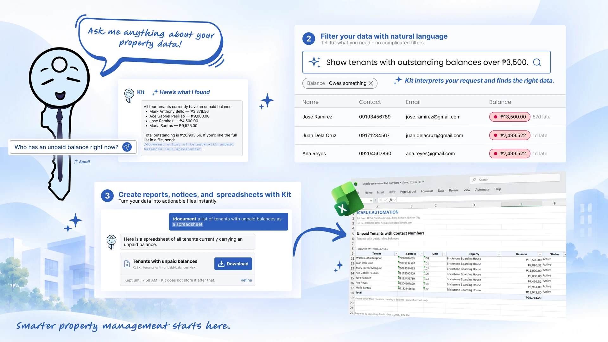

<div align="center">
  
</div>

<div align="center">
  
</div>

## `~/` whoami

```console
$ cat about.txt
```

Hi, I’m **Ace**. 5+ years building software plus integrating it into hardware: web apps, APIs, and IoT projects. I enjoy working at both ends of the stack, from polished web interfaces to low-level systems code, and I deploy and maintain everything I ship, from the code down to the servers it runs on.

For **freelance work?** do reach out at acegabriel0809@gmail.com

<a href="https://github.com/acethekawaii"></a>

<!-- Hi, I'm **Ace**. I build polished software that people actually use... turning digital systems into intelligent ones through AI, automation, and IoT. -->

## currently working on



### [LeaseTing](https://icarusautomation.tech/solutions/leaseting)

**A property management ERP with built-in AI.**

Built for property teams tired of juggling spreadsheets, Leaseting brings tenant records, leases, billing, maintenance, and parking into one workspace. Its built-in AI agents help property managers generate reports in their liking.

[](https://icarusautomation.tech/solutions/leaseting)

**Built with**


## personal projects tier list

I joined GitHub **4 years** ago and have since shipped multiple projects both personal and client. Here’s how I’d rank a few of them.

| Tier | Repositories |
| :--: | :----------- |
|  | [](https://github.com/Icarus-Automation/leaseting-client) |
|  | [](https://github.com/acethekawaii/astryss-frontend) [](https://github.com/icarus-automation/keepinv-client) |
|  | |
|  | [](https://github.com/acethekawaii/attendify-frontend)  |
|  | |

### Tools I use in this AI era 

Some help me write code. Others run the tasks I got tired of doing by hand.

<div>
  &nbsp;
  &nbsp;
  &nbsp;
  &nbsp;
  
  
  
  &nbsp;
</div>

<br>

<details>
<summary>
  Before AI, I wrote code by hand with this stack. Still am, now with a team of AI agents.
</summary>

### I'm an Angular, NestJS, & Postgres fanboy, Everything else is side chicks.

[](https://www.youtube.com/watch?v=dQw4w9WgXcQ&list=RDdQw4w9WgXcQ&start_radio=1)
[](https://www.youtube.com/watch?v=dQw4w9WgXcQ&list=RDdQw4w9WgXcQ&start_radio=1)

### The rest of my setup

Editors, deployment tools, an Arduino for the hardware side of things, and Spotify because the code needs a soundtrack.


 


</details>

## top languages


## contribution calendar


### codewars

<a href="https://www.codewars.com/users/lugh-tuatha">
  
</a>

## wakatime Stats:

<a href="https://wakatime.com/@lughtuatha" title="Data update every midnight"></a>

<!--  -->

<!-- If wakatime stats don't work, he must be cosplaying Cloudflare  -->

## say hi

Got a project in mind? Catch me on Discord. 

[](https://discord.com/users/971077954941620276)

Just passing through? Leave a note in my guestbook.

[](https://github.com/acethekawaii/acethekawaii/issues)

---
### visitors
<div align="left">
  
</div>

> Last Manually Edited: 2026-11-12